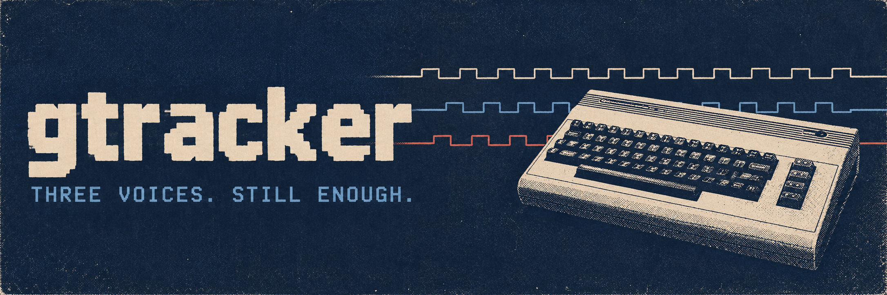

# GTracker - The Ultimate SID Tracker

[Website](https://timosaarinen.github.io/gtracker/) · [SID manual](docs/sid-tracker.md)

**Do you remember C64? Did you feel the magic of SID music?**

Sometimes the best part of a C64 game was leaving the title screen running.
That bass line. Those drums. All that noise coming out of one little chip.

GTracker is for making some of your own. A native desktop tracker with three
SID voices, keyboard note entry, reusable patterns and realtime playback.
Write a tune, hear it as you go, and export a real SID file or a runnable C64
program. It's 2026. We can at least have decent title music.

## What you get

- **Three voices, PAL/6581 sound.** Pick a preset and start entering notes.
  Playback uses libsidplayfp/reSIDfp and the GoatTracker player.
- **A tracker you can play.** Notes audition as you enter them. Loop a pattern,
  build variations, arrange sections, undo the bit that sounded better in your head.
- **Your songs, saved locally.** Editable song files, Save As, undo/redo and
  recovery copies. No account required.
- **SID, PRG, WAV and MP4 export.** The video has your song title, three voice
  oscilloscopes and a full-screen spectrum, bass on the left and treble on the right.
- **Readable on a modern monitor.** Adjustable 100–400% interface scale, with
  200% as the default on 4K displays.

## Start making noise

Download the [first release, v0.5.0-rc.1](https://github.com/timosaarinen/gtracker/releases/tag/v0.5.0-rc.1):

- [Windows x64 portable ZIP](https://github.com/timosaarinen/gtracker/releases/download/v0.5.0-rc.1/gtracker-v0.5.0-rc.1-windows-x64.zip)
- [Linux x86_64 portable ZIP](https://github.com/timosaarinen/gtracker/releases/download/v0.5.0-rc.1/gtracker-v0.5.0-rc.1-linux-x86_64.zip)

Extract the whole folder. On Windows, open **Start SID Tracker.cmd**; on Linux,
run `./start-sid.sh`. Windows needs the Visual C++ x64 runtime; Linux needs the
SDL 1.2 ABI library. See the release notes for prerequisites. These are prerelease
builds; macOS comes later.

Prefer running from source? Use:

```sh
git clone https://github.com/timosaarinen/gtracker.git
cd gtracker
bun run dev
```

<details>
<summary>First run: tools you'll need</summary>

Install Python 3.10+, CMake 3.25+, Ninja and a C++17 toolchain. Bun runs the
shortcut above; `python tools/dev.py dev` works without it. No `bun install` needed.

On Windows, use a Visual Studio developer terminal with the Windows SDK.
The SID backend also needs MSYS2 at `C:/msys64`, with i686 GCC/SDL and UCRT64
GCC/autotools. First setup downloads checksum-pinned dependencies.

On Linux, follow the [build instructions and dependency list](docs/linux.md).
The launcher builds the editor and prepares missing SID helpers.

macOS support is coming later, starting with verification on an Intel Mac.

</details>

Try **Heavy and Mellow**, the included original two-minute song:

```sh
bun run dev examples/sid/heavy-mellow.sidtrk.json
```

Pull it apart. Change the lead, rearrange the sections, make the bass obnoxious.
Use **Save As** to keep your version.

## Your first pattern

1. Choose a preset, click a NOTE cell and leave **Edit** enabled.
2. Play `Z S X D C V G B H N J M`. The row above,
   `Q 2 W 3 E R 5 T 6 Y 7 U`, plays the next octave.
3. Use `A` for note-off, Delete to clear, and Tab to move between voices.
4. **F6** loops the pattern. **F5** plays the song. **F8** stops.
   Space starts at the selected row, then pauses or resumes.
5. Save with **Ctrl+S**. Arrange your patterns into a song and hit **Export SID**.

The [SID guide](docs/sid-tracker.md) covers block editing, variations, sections,
shortcuts and the details of each export format.

## Put it on a real C64. Or the internet.

**Export SID** saves the music as a SID file. **More > Export C64 Program** makes a
runnable PRG. WAV export gives you the audio; **More > Export MP4 Video** adds
the scopes, spectrum and title for sharing.

MP4 needs FFmpeg. On Windows, choose **More > Set up MP4 export > Download FFmpeg**.
It checks the download and installs it in your user-data folder, without admin
rights. On Linux, install FFmpeg through your package manager. An existing FFmpeg
on PATH works too. Upload the finished video wherever you like.

## And the guitar?

There's also an experimental acoustic-guitar editor, built for music authoring
in my MMO, *Lust of War*. That's where the project started. The SID tracker now
has its own screen and workflow; the guitar work continues alongside it.

Run `bun run dev --guitar` to try it. Expect physical-synthesis experiments,
not a finished acoustic-guitar replacement. See the [guitar guide](docs/editor.md).

## Under the lid

GTracker is open source. Bugs and small, reproducible examples are welcome in
[Issues](https://github.com/timosaarinen/gtracker/issues).
For building, testing and contributing, start with [CONTRIBUTING.md](CONTRIBUTING.md).
The [architecture](docs/architecture.md) and [realtime audio notes](docs/realtime.md)
go into the machinery.

Windows and Linux builds have automated playback, export and package checks.
Physical-device testing is still incomplete; see [platform status](docs/release.md)
for the specifics. macOS releases are deferred.

Project code is [MIT licensed](LICENSE), with explicitly marked GPL-2.0-or-later
SID helpers. Dependencies keep their own licenses; see [third-party notices](THIRD_PARTY_NOTICES.md).
